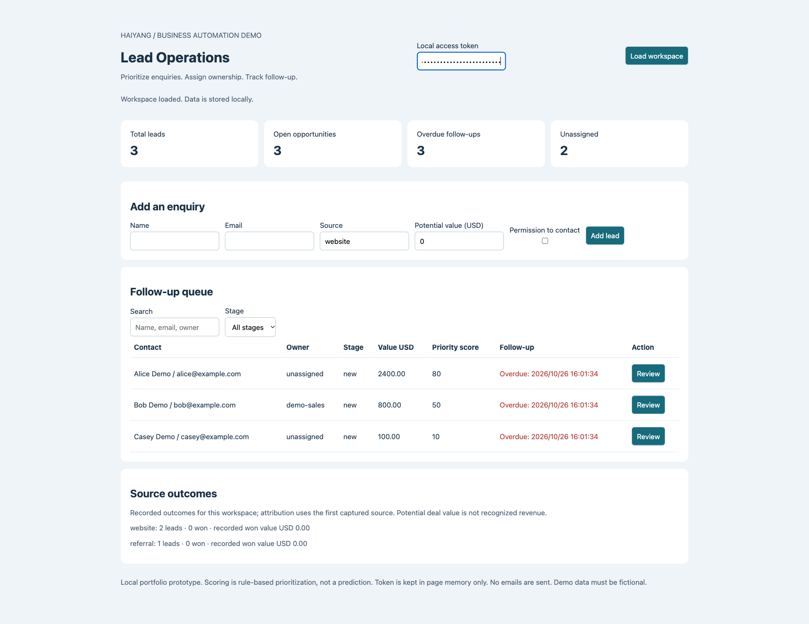
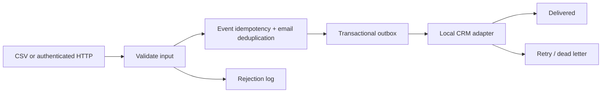

# Lead Operations — Enquiry to Follow-up

**Business question:** Which enquiries need attention now, who owns them, and what happened next?



Version 0.3 adds an interactive local sales console on top of the existing intake/outbox pipeline. It supports lead capture, first-touch source attribution, owner assignment, rule-based prioritization, follow-up deadlines, stage changes, won/lost tracking, and an append-only activity history. Optimistic versions prevent one operator from overwriting another operator's changes.

## Run the interactive demo

Python 3.10+, standard library only, from this repository root:

```sh
python3 operations.py --db /tmp/lead-ops-demo.db seed
# Set INTAKE_TOKEN in your shell to your own random secret of at least 24 characters.
python3 app.py --db /tmp/lead-ops-demo.db --port 8091
```

Open `http://127.0.0.1:8091`, paste the same token into the local token field, and load the workspace. No account signup or paid API is required. The seed uses example.com contacts. Use a new database path for a fresh demo.

**Try this acceptance walkthrough:** inspect overdue/unassigned leads → assign an owner → move `new → contacted → qualified → proposal → won` → record a note supporting the won outcome → inspect source outcomes and activity history. Skipping directly from new to won is rejected. Saving an old version is rejected rather than overwriting newer work. Use the search/stage filters to find open enquiries.

## Commercial use and measurement

Useful starting scope for a small service business receiving website/referral enquiries. Sell a defined intake-and-follow-up workflow with field mapping, owner rules and handover, rather than an unspecified “AI system.” Measure before/after duplicate count, unassigned lead count, overdue follow-up count and recorded stage conversion over a defined period. No measured customer improvements are claimed here.

Scoring is explainable: contact permission +20, urgency +30, potential value ≥ USD 1,000 +30 (positive smaller values +10), assigned owner +20. This prioritizes work; it does not predict purchase probability. Deadline is initially 24 hours after capture. Values are USD potential deal values, not booked revenue. First captured source is retained on duplicates; no multi-touch attribution is claimed.

## API and data boundaries

`GET /api/dashboard`, `GET /api/leads/{id}/activities`, `POST /api/leads`, `POST /api/leads/{id}`. All data endpoints require a bearer token. Capture requires `Idempotency-Key`; updates require `version`, `actor`, and `changes`. Contact permission is recorded, not inferred. No outbound email/SMS action exists. Operators should respect permission and applicable outreach rules before adding an external messaging integration.

The console is loopback-only and has a single shared local token. Actor/owner names are labels, not authenticated users or RBAC. Existing v0.2 CSV imports remain in the intake pipeline; operations records are created by the new capture path, not retroactively fabricated for old imports. SQLite additive schemas support the demo upgrade, not a production migration program. Capture and profile creation are two transactions; a replay can repair a missing profile after a crash. Multi-team tenancy, retention/deletion tooling, remote CRM connectors, scheduled alerts, TLS and production hosting remain out of scope.

## Verification

Run `python3 -m unittest discover -s tests -v`. Tests cover the original pipeline plus stage constraints, stale updates, monetary validation, rollback, source preservation and won totals.

## Previous interface intake/outbox interface (still supported)

# Lead Intake Pipeline

**From messy contact inputs to a traceable, duplicate-safe intake workflow.**

A Python portfolio prototype with CSV intake, a local authenticated HTTP endpoint, durable SQLite records, a delivery queue, bounded retry/backoff, dead-letter state, and a local CRM adapter.

## Workflow



## Quick start

Python 3.10+, no third-party dependencies. From the repository root:

```sh
python3 pipeline.py --db /tmp/intake-demo.db import examples/leads.csv
python3 pipeline.py --db /tmp/intake-demo.db import examples/leads.csv
python3 pipeline.py --db /tmp/intake-demo.db drain --crm /tmp/crm-demo.db
python3 pipeline.py --db /tmp/intake-demo.db status
python3 pipeline.py --db /tmp/intake-demo.db errors --output /tmp/rejections.csv
python3 -m unittest discover -s tests -v
```

Use new database filenames for a fresh demo. First import: 2 accepted, 1 duplicate, 1 rejected. Repeat import returns persisted event results with `replayed: true` and creates no new leads. Same event ID plus changed payload is rejected. Emails are normalized; existing leads are not silently overwritten.

## Local webhook

Set `INTAKE_TOKEN` to your own random secret of at least 24 characters, then:

```sh
python3 pipeline.py --db /tmp/intake-demo.db serve --port 8080
```

POST JSON `{ "name": "Alice", "email": "alice@example.com" }` to `http://127.0.0.1:8080/leads` with `Authorization: Bearer <your token>` and `Idempotency-Key: <unique event ID>`. Maximum body size: 16 KB. Unknown routes return 404, unauthorized calls 401, invalid contacts 422, malformed events 400. The server binds to localhost. Do not expose this standard-library server to the internet.

## Delivery guarantees and limits

Lead creation, event result persistence, and outbox enqueue are one SQLite transaction. The demo CRM uses source IDs to avoid duplicate writes if delivery is retried after a crash. Retry delays are 2, 4, and 8 seconds; the third failure moves an item to `dead`. Run `drain` again when pending items become due; there is no background scheduler. Dead items remain inspectable in SQLite for manual diagnosis; automatic requeue is not implemented.

The CRM is a second local database, **not Salesforce/HubSpot integration**. A real adapter needs provider authentication, timeout and rate-limit policies, external idempotency keys, and reconciliation. The current adapter assumes one source database per destination. Email syntax checks are not deliverability checks. Production deployment additionally needs TLS, managed secrets, access controls, load limits, backups, monitoring, data retention, and migrations. Do not commit customer data.

## Evidence

Tests cover replay/conflict handling, normalized duplicates, persistent rejection logging, retry timing/dead letters, and recovery after a CRM write. See [tests](tests/test_pipeline.py). All examples use fictional data; no client outcomes are claimed.
