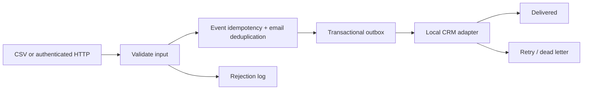

# Lead Intake Pipeline

**From messy contact inputs to a traceable, duplicate-safe intake workflow.**

A Python portfolio prototype with CSV intake, a local authenticated HTTP endpoint, durable SQLite records, a delivery queue, bounded retry/backoff, dead-letter state, and a local CRM adapter.

## Workflow



## Quick start

Python 3.10+, no third-party dependencies. From the repository root:

```sh
python3 pipeline.py --db /tmp/intake-demo.db import examples/leads.csv
python3 pipeline.py --db /tmp/intake-demo.db import examples/leads.csv
python3 pipeline.py --db /tmp/intake-demo.db drain --crm /tmp/crm-demo.db
python3 pipeline.py --db /tmp/intake-demo.db status
python3 pipeline.py --db /tmp/intake-demo.db errors --output /tmp/rejections.csv
python3 -m unittest discover -s tests -v
```

Use new database filenames for a fresh demo. First import: 2 accepted, 1 duplicate, 1 rejected. Repeat import returns persisted event results with `replayed: true` and creates no new leads. Same event ID plus changed payload is rejected. Emails are normalized; existing leads are not silently overwritten.

## Local webhook

Set `INTAKE_TOKEN` to your own random secret of at least 24 characters, then:

```sh
python3 pipeline.py --db /tmp/intake-demo.db serve --port 8080
```

POST JSON `{ "name": "Alice", "email": "alice@example.com" }` to `http://127.0.0.1:8080/leads` with `Authorization: Bearer <your token>` and `Idempotency-Key: <unique event ID>`. Maximum body size: 16 KB. Unknown routes return 404, unauthorized calls 401, invalid contacts 422, malformed events 400. The server binds to localhost. Do not expose this standard-library server to the internet.

## Delivery guarantees and limits

Lead creation, event result persistence, and outbox enqueue are one SQLite transaction. The demo CRM uses source IDs to avoid duplicate writes if delivery is retried after a crash. Retry delays are 2, 4, and 8 seconds; the third failure moves an item to `dead`. Run `drain` again when pending items become due; there is no background scheduler. Dead items remain inspectable in SQLite for manual diagnosis; automatic requeue is not implemented.

The CRM is a second local database, **not Salesforce/HubSpot integration**. A real adapter needs provider authentication, timeout and rate-limit policies, external idempotency keys, and reconciliation. The current adapter assumes one source database per destination. Email syntax checks are not deliverability checks. Production deployment additionally needs TLS, managed secrets, access controls, load limits, backups, monitoring, data retention, and migrations. Do not commit customer data.

## Evidence

Tests cover replay/conflict handling, normalized duplicates, persistent rejection logging, retry timing/dead letters, and recovery after a CRM write. See [tests](tests/test_pipeline.py). All examples use fictional data; no client outcomes are claimed.
